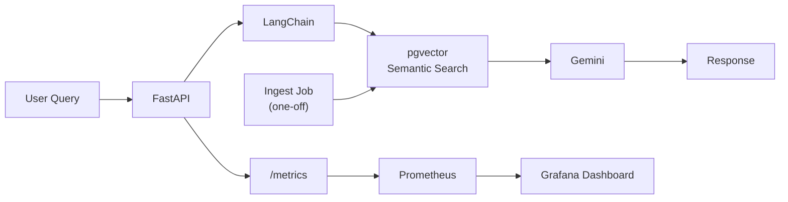

# RAG on Kubernetes

[](https://github.com/akshatkarnwal/rag-k8s/actions/workflows/ci.yml)

A production-shaped RAG service on Kubernetes (minikube) — FastAPI + pgvector + Gemini + Prometheus + Grafana. The focus is the operational side of an LLM app: probes, autoscaling, observability, and how the service behaves under load and under an upstream rate limit.

## Architecture



## Stack

|     Component    |           Technology                                                                          |
|------------------|-----------------------------------------------------------------------------------------------|
| API              | FastAPI + Uvicorn                                                                             |
| RAG Framework    | LangChain                                                                                     |
| Vector DB        | pgvector (PostgreSQL), exact (non-indexed) search                                             |
| LLM              | Gemini 2.5 Flash                                                                              |
| Embeddings       | Gemini Embedding 2 (3072-dim)                                                                 |
| Auth             | JWT (python-jose/bcrypt)                                                                      |
| Task Queue       | Celery + Redis (scaffolding, docker-compose only — see [Task Queue](#task-queue-in-progress)) |
| Orchestration    | Kubernetes (minikube)                                                                         |
| Autoscaling      | HPA (CPU + memory), 1–3 replicas                                                              |
| Observability    | Prometheus + Grafana                                                                          |
| Containerisation | Docker                                                                                        |
| Testing & CI     | pytest, pytest-mock, GitHub Actions                                                           |
| Load Testing     | Locust                                                                                        |

## Features

- Document ingestion pipeline with chunking and embedding, run once as a Kubernetes Job (not on every pod start)
- Semantic search over pgvector; one retrieval and one Gemini call per `/query`
- Separate startup, liveness (`/health`) and readiness (`/ready`: RAG chain built and Postgres reachable) probes
- JWT-authenticated `/query` endpoint — `/health`, `/ready` and `/metrics` stay open for probes/scraping
- Upstream rate limits fail fast: Gemini 429s return `503` with `Retry-After`, not a slow `500`
- Prometheus metrics: query rate (by status), P95 latency (failed requests included), docs indexed, chunks retrieved
- Grafana dashboards for real-time observability
- HPA autoscaling between 1–3 replicas on CPU and memory
- Kubernetes Secrets for API key management; images tagged with the git SHA on deploy
- Automated test suite (21 tests, pytest) with mocked dependencies, run on every push and pull request via GitHub Actions
- Load tested with Locust, including an autoscaling run — see [Load Testing](#load-testing)
- Celery + Redis task queue wired up in docker-compose and verified end-to-end (worker/broker/result-backend loop); no application logic routed through it yet — see [Task Queue](#task-queue-in-progress)

## Quick Start

### Local development

```bash
# clone and setup
git clone https://github.com/akshatkarnwal/rag-k8s
cd rag-k8s
cp .env.example .env  # add your GEMINI_API_KEY and auth settings — see Authentication section below
                       # set INGEST_ON_STARTUP=true for the first run so the collection gets populated

# start pgvector
docker run -d --name pgvector \
  -e POSTGRES_PASSWORD=postgres \
  -e POSTGRES_DB=vectordb \
  -p 5432:5432 pgvector/pgvector:pg16

# install and run
uv sync
uv run uvicorn app.main:app --reload --port 8000
```

Ingestion at startup is off by default (`INGEST_ON_STARTUP=false`). You can also run it on its own with `uv run python -m app.ingest`. If `data/` is empty, ingestion falls back to six sample runbook lines.

### Deploy to Kubernetes

```bash
# start minikube
minikube start

# create the Secret once (k8s/secret.yaml is gitignored)
cp k8s/secret.example.yaml k8s/secret.yaml   # fill in GEMINI_API_KEY, DB_PASSWORD,
                                              # JWT_SECRET_KEY, DEMO_USERNAME,
                                              # DEMO_PASSWORD_HASH (single $ signs)
kubectl apply -f k8s/secret.yaml

# build, deploy, and (first time or when data changes) run the ingest Job
./k8s/deploy.sh --ingest

# get service URL
minikube service rag-k8s-service --url
```

`k8s/deploy.sh` builds the API image inside minikube's Docker daemon, tags it with the current git SHA, applies the manifests (including the ServiceMonitor), optionally runs the ingest Job, and waits for the rollout. Run it from the repo root. Re-running it without `--ingest` redeploys the API only.

The ServiceMonitor needs the Prometheus Operator CRDs installed in the cluster (for example via kube-prometheus-stack); the script warns and continues if they are missing.

**Note:** each deploy names the running image after the commit (`rag-k8s-rag-api:<sha>`), so the manifest can't silently point at stale code. Check what is running with:

```bash
kubectl get deployment rag-k8s -o jsonpath='{.spec.template.spec.containers[0].image}'
```

## Authentication

The `/query` endpoint requires a JWT bearer token. `/health`, `/ready` and `/metrics`
are intentionally left open, since health probes and Prometheus scraping
shouldn't require a login.

```bash
# 1. get a token
curl -X POST http://localhost:8000/token \
  -d "username=<your-username>&password=<your-password>"

# 2. use it to call the protected endpoint
curl -X POST http://localhost:8000/query \
  -H "Content-Type: application/json" \
  -H "Authorization: Bearer <paste-token-here>" \
  -d '{"question": "How do I restart the DNIF worker?"}'
```

This project uses a single demo user (configured via environment
variables) rather than a full user table — a reasonable, honest scope
for a personal project. Swapping `verify_demo_user()` in `app/auth.py`
for a real lookup against a `users` table in the existing Postgres
instance would be the natural next step for a multi-user system; the
JWT issuance/verification mechanics stay the same either way.

Required environment variables (see `.env.example`):

|      Variable         |                  Purpose                                      |
|-----------------------|---------------------------------------------------------------|
| `JWT_SECRET_KEY`      | Signing key for tokens — generate with `openssl rand -hex 32` |
| `JWT_EXPIRE_MINUTES`  | Token lifetime (default: 60)                                  |
| `DEMO_USERNAME`       | The single demo user's username                               |
| `DEMO_PASSWORD_HASH`  | Bcrypt hash of the demo password — never store plaintext      |
| `INGEST_ON_STARTUP`   | `true` to ingest `data/` when the app starts (default: false) |

Generate a `DEMO_PASSWORD_HASH` with:
```bash
python3 -c "import bcrypt,getpass; print(bcrypt.hashpw(getpass.getpass().encode(), bcrypt.gensalt()).decode())"
```

**A note on `$` in the hash.** Docker Compose treats `$` in `.env` as variable interpolation, so a hash used by compose must be written with every `$` doubled (`$$`). The app itself reads the value literally, so outside compose (plain `uvicorn`, or the Kubernetes Secret) use the single-`$` form — for local runs, `export DEMO_PASSWORD_HASH='<hash>'` in your shell, which takes precedence over `.env`. A doubled hash fails every login with a 401.

## API

```bash
# liveness (no auth required)
curl http://localhost:8000/health

# readiness: RAG chain built and Postgres reachable (no auth required)
curl http://localhost:8000/ready

# query (auth required — see Authentication section)
curl -X POST http://localhost:8000/query \
  -H "Content-Type: application/json" \
  -H "Authorization: Bearer <token>" \
  -d '{"question": "How do I restart the DNIF worker?"}'

# prometheus metrics (no auth required)
curl http://localhost:8000/metrics
```

`/query` errors: `400` empty question, `401` missing/invalid token, `422` malformed body, `503` (with `Retry-After`) when Gemini's rate limit is hit, `500` for anything else (details are logged, not returned).

## Testing

The test suite mocks `ingest_documents` and `build_rag_chain` before FastAPI's
lifespan runs, so tests never touch a real Postgres instance or the real
Gemini API — fast, free, and deterministic. Auth-related tests patch
`app/auth.py`'s module-level constants directly (rather than just the
environment), since those values are read once at import time.

```bash
# install test dependencies
uv add --dev pytest pytest-mock httpx

# run the suite (21 tests)
uv run pytest -v
```

Coverage includes:
- Root and health endpoint checks
- `/ready`: 200 with a reachable database, 503 when the database is down or the chain is missing, no internals leaked
- Prometheus metrics endpoint (format and exact increment of the success counter)
- Auth: successful login, wrong username/password, missing/invalid token
- `/query` happy path (with a valid token), with exact response-shape assertions
- `/query` makes exactly one chain call per request (regression guard for double retrieval)
- Validation: missing `question` field (422) vs. empty/whitespace string (400)
- Error handling: a chain failure returns a 500 whose body does not contain the exception text, and increments the error counter
- Upstream quota errors (`429 RESOURCE_EXHAUSTED`) map to a 503 with `Retry-After`

## CI/CD

Every push and pull request to `master` runs the full test suite via GitHub
Actions (`.github/workflows/ci.yml`), using `uv sync --locked` to install
the exact dependency versions from `uv.lock` — so CI always matches what's
tested locally, not just whatever resolves at the time. The workflow
supplies dummy auth credentials as environment variables (never real
secrets) so the test suite's auth coverage runs the same way in CI as
it does locally.

## Key Design Decisions

**Why pgvector over Pinecone?**
pgvector runs inside PostgreSQL — no additional infrastructure. For thousands to millions of documents, it's the right tradeoff between simplicity and scale. This project currently runs exact (non-indexed) search over a small corpus; an HNSW index is not set up, and at 3072 dimensions would need a reduced dimension or `halfvec` (pgvector's HNSW limit is 2,000 dimensions for `vector`).

**Why chunk_size=500, overlap=100?**
Small chunks lose context; large chunks reduce retrieval precision. 500 characters with 100-character overlap preserves semantic units while keeping retrieval focused. I haven't benchmarked other sizes — there is no retrieval evaluation in this project yet.

**Why HPA on CPU+memory?**
CPU is the signal that matters here. The API itself is mostly I/O-bound (embeddings and generation are Gemini API calls), and the CPU load I actually measured came from bcrypt password verification on `/token`. Utilization targets are percentages of the container's *requests* (250m CPU, 512Mi), not its limits — so the 70% CPU target is about 175m per pod, and a pod pinned at its 500m limit reads as ~200%. Memory is a weak secondary signal for a Python API: it plateaued at 30–39% in every load test and never drove scaling. The HPA owns the replica count, so the Deployment deliberately has no `replicas:` field.

**Why separate startup, liveness and readiness probes?**
Liveness (`/health`) is cheap and has no dependencies, so a database outage doesn't restart healthy pods. Readiness (`/ready`) checks the RAG chain and a `SELECT 1`, so a pod that can't reach Postgres stops receiving traffic. A startup probe gives the app time to build the chain before liveness begins.

**Why is ingestion a one-off Job instead of part of startup?**
Postgres is on a PersistentVolume, so the data survives pod restarts. If every pod wiped and re-embedded the collection on start, scale-out and rolling deploys would race with each other, burn API quota, and could leave queries with an empty collection. Ingestion now runs once (`k8s/ingest-job.yaml`, via `deploy.sh --ingest`) or locally with `INGEST_ON_STARTUP=true`. The ingest replaces the whole collection, so queries can briefly return nothing while it runs.

**Why one retrieval per request?**
The chain returns both the retrieved documents and the answer, so `/query` embeds the question once and reads the chunk count from the same result. The first version retrieved twice (once for the chunk count, once inside the chain), doubling embedding calls against a rate-limited API.

**Why fail fast on Gemini rate limits?**
The Gemini client is configured with `max_retries=2, timeout=20`, and a 429 maps to `503` with `Retry-After: 60`. The free tier's limit is per minute (see [Load Testing](#run-2--after-the-fixes)), and a few seconds of backoff can't outlast a window the API says to wait ~42s for, so more retries only hold a worker thread for nothing. Failed requests are also recorded in the latency histogram, so slow failures show up in P95.

**Why `Recreate` for the Postgres Deployment?**
The data volume is `ReadWriteOnce`. With the default rolling update, the new Postgres pod can start while the old one still has the volume mounted. `Recreate` stops the old pod first.

**Why Kubernetes Secrets for API keys?**
Secrets are injected as environment variables at runtime — rotating a key means updating the Secret and rolling the Deployment, with no code change required. (Secrets are only base64-encoded; in production, add encryption at rest and an external secrets manager.)

**Why JWT with bcrypt instead of a simpler API key?**
JWTs carry an expiry and can be verified statelessly without a database lookup on every request. bcrypt's intentional CPU cost protects against offline brute-forcing of the stored password hash — though as load testing below shows, that same CPU cost becomes a real constraint under the deployment's CPU limits.

**Why Celery + Redis for the task queue?**
Celery is the standard, well-supported choice for Python background task processing, with built-in retry semantics and broker flexibility. Redis is the broker because it's already part of the docker-compose stack. It runs in compose only for now; there are no Kubernetes manifests for Redis or the worker yet.

**Why mock the RAG chain in tests instead of hitting the real Gemini API?**
Gemini's free tier is tightly rate-limited. Mocking `build_rag_chain` and
`ingest_documents` at the FastAPI lifespan boundary keeps the test suite
fast and free to run on every single commit, while still exercising the
real request/response contract of the API itself.

**Why a single demo user instead of a full auth system?**
Scope-appropriate for a personal project — the goal was to demonstrate
real JWT issuance/verification mechanics on a production-shaped API, not
to build a user-management system. The mechanics (signing, expiry,
bearer-token verification) are identical to what a multi-user system
would use.

## Observability

Prometheus scrapes `/metrics` every 15 seconds via ServiceMonitor.

|           Metric            |    Type   |        Description                         |
|-----------------------------|-----------|--------------------------------------------|
| `rag_query_total`           | Counter   | Total queries by status (success / error)  |
| `rag_query_latency_seconds` | Histogram | Query latency, successes and failures      |
| `rag_chunks_retrieved`      | Histogram | Chunks retrieved per query                 |
| `rag_docs_indexed_total`    | Gauge     | Documents indexed in pgvector              |

These measure traffic, latency and retrieval volume. None of them measure answer quality.

## Load Testing

Load tested with [Locust](https://locust.io/) against the minikube-deployed service. The raw CSVs for each run are in `results/`.

### Setup

```bash
uv add --dev locust
export DEMO_USERNAME=<demo-username>
export DEMO_PASSWORD=<demo-password>

# use the NodePort URL, not `kubectl port-forward` (a port-forward pins traffic to one pod)
HOST="$(minikube service rag-k8s-service --url)"

# /query load (calls Gemini); the cap protects the free-tier quota
MAX_QUERY_REQUESTS=25 uv run locust -f locustfile.py --host "$HOST" \
  --headless -u 3 -r 1 -t 120s --csv=results/run2

# CPU load for the HPA (repeated /token logins, no Gemini calls)
uv run locust -f locustfile_hpa.py --host "$HOST" \
  --headless -u 8 -r 2 -t 3m --csv=results/run5_hpa
```

- `locustfile.py` simulates an authenticated `RagQueryUser` (logs in once via `/token`, then repeatedly calls `/query`) and a lightweight unauthenticated `HealthCheckUser` hitting `/health`, weighted 9:1. A cap on total `/query` calls (`MAX_QUERY_REQUESTS`, default 15) stops the run before it burns the free-tier quota.
- `locustfile_hpa.py` only repeats `/token` logins. bcrypt makes that endpoint CPU-bound, and it makes no Gemini calls, so it can run as long as needed to exercise the HPA.

### Run 1 — before the fixes

**Baseline — 2 concurrent users, 30s:**

| Endpoint | Requests | Failures | Median latency  |
|----------|----------|----------|-----------------|
| `/query` | 4        | 0%       | 3.8s            |
| `/token` | 2        | 0%       | 1.7s            |

At light load, the full pipeline (JWT auth → retrieval → Gemini generation) works cleanly end-to-end, with `/query` latency dominated by the Gemini API round-trip.

**Under load — 10 concurrent users** surfaced two bottlenecks:

1. **Gemini free-tier rate limit** was exhausted almost immediately. The client's default retry policy (`tenacity`, exponential backoff on `429 RESOURCE_EXHAUSTED`, ~6 attempts) meant each failed `/query` retried silently before giving up — driving latency to 51–56 seconds before returning a 500, instead of failing fast.
2. **bcrypt login showed CPU contention** under the pod's `500m` CPU limit. With 9 concurrent logins, `/token` latency went from ~1.7s to 6.5–11s, with zero failures.

| Endpoint | Requests | Failures | Latency (min–max)                     |
|----------|----------|----------|---------------------------------------|
| `/query` | 9        | 100%     | 51.6s – 55.8s (failed after retries)  |
| `/token` | 9        | 0%       | 6.5s – 11.0s                          |
| `/health`| 19       | 0%       | 4ms – 353ms                           |

### Run 2 — after the fixes

Changes made after run 1: `max_retries=2, timeout=20` on the Gemini client, 429 → `503` + `Retry-After`, latency recorded for failures, a single retrieval per request, and ingestion removed from pod startup. Run 2 used 3 users and a cap of 25 `/query` attempts.

| Endpoint | Reqs | Failures      | Latency range |
|----------|------|---------------|---------------|
| `/query` | 23   | 17 (all 503)  | 2.2s – 3.9s   |
| `/token` | 3    | 0             | 1.7s – 2.6s   |

- Server-side, 25 attempts were made: 6 succeeded and 19 were rejected with a Gemini 429 (Locust recorded 23 of them; the last two were still in flight at shutdown).
- The 429 payload shows the limit that was hit: `GenerateRequestsPerMinutePerProject` — 5 requests per minute for `gemini-2.5-flash` on the free tier (as observed in October 2026; free-tier limits change), with a suggested retry in ~42s. So this is a per-minute limit, not a daily cap.
- The slowest `/query` of the whole run (3.9s) is now far below the 51–56s failures of run 1. Run 1 and run 2 differ in load (10 vs 3 users), so the comparison that matters is failure latency and status code, not failure rate.

### Runs 3–5 — autoscaling

The HPA run drives CPU with `/token` logins (8 users). Each row is one run:

| Run | Setup                              | Reqs | Median | p95   | Req/s | Logins per pod |
|-----|------------------------------------|------|--------|-------|-------|----------------|
| 3   | 1 → 3 autoscaled, keep-alive       | 159  | 11.0s  | 16s   | 0.66  | all on 1st pod |
| 4   | same as run 3                      | 164  | 11.0s  | 15s   | 0.68  | all on 1st pod |
| 5   | 3 pods up, new connection/request  | 304  | 3.8s   | 8.7s  | 1.69  | 120 / 97 / 87  |

All three runs had 0 failures.

**What happened in run 3:** CPU went from ~1% to 135% of the request (HPA: 1 → 2 replicas), then 200% (2 → 3; capped at `maxReplicas`). The first rescale came about 2 minutes after the load started, the second about a minute later, and each new pod became Ready roughly 40 seconds after it was created. The pods showed no restarts during the run.

**But the new pods got no traffic.** Per-pod log counts showed all 162 logins on the original pod and none on the new ones, and latency never improved (run 4 repeated this: 164 of 164 on the original pod). Kubernetes Services balance per TCP connection, not per request, and Locust's keep-alive connections stayed pinned to the pod they first connected to. The average CPU readings fit this: 200% on one pod, then 100% with 2 ready pods, then 67% with 3.

**Run 5** made every request open a fresh connection (`Connection: close`). With the same 8 users and 3 pods already running, the load split roughly evenly (120 / 97 / 87), median latency dropped from 11.0s to 3.8s, and throughput rose from 0.68 to 1.69 req/s (about 2.5× for 3× the pods).

Caveats: run 5 started with 3 replicas already up (after a minikube restart), so it measures steady-state capacity, not the autoscaling transition. The gain is below linear, likely because minikube and the load generator share one laptop's CPU (not verified), and the split across pods wasn't perfectly even.

### Takeaways

- **Failure behavior is now bounded.** An exhausted Gemini quota used to turn each request into a ~55-second `500`; it is now a `503` with `Retry-After` in under 4 seconds.
- **bcrypt makes `/token` the CPU hotspot.** Login latency is 1.7–2.6s idle and ~11s with 8 concurrent users on one pod. A production deployment would raise the CPU limit, lower the bcrypt work factor, or move to a session-token model that avoids re-hashing on every login.
- **The HPA works, but scale-out only helps if traffic spreads.** CPU-based scaling fired as designed and new pods were Ready in about 40 seconds, but long-lived client connections never reached them. Short-lived connections (or a request-level load balancer such as an Ingress) are what makes extra replicas useful.
- **`/health` stayed fast during run 1**, including while `/query` was failing — the failures were isolated to the Gemini-dependent path.

### Limits of these tests

Everything ran on one laptop (minikube, Locust and the desktop sharing the same CPU), runs were short, and each configuration was run once or twice. The numbers show behavior and relative change, not production capacity.

## Task Queue (in progress)

Celery + Redis are wired up (`app/tasks.py`, `app/worker.py`) and verified working end-to-end in docker-compose — a task submitted via `.delay()` is picked up by the worker and its result retrieved via `.get()`. Currently this proves the worker/broker/result-backend loop only; no application logic runs through it yet, and there are no Kubernetes manifests for Redis or the worker. The planned next step is moving document ingestion onto this queue so re-indexing large runbook sets doesn't block the API.

## Known limitations and next steps

- Retrieval uses exact search with no ANN index, and there is no retrieval evaluation yet. Planned: build an HNSW index (reduced dimension or `halfvec`) and measure recall vs latency against exact search.
- With an empty `data/` directory, ingestion falls back to six sample runbook lines; the corpus is tiny.
- `PGVector` comes from `langchain-community`, which is being sunset; the replacement is `langchain-postgres` (it changes the collection schema, so it needs a migration).
- `Retry-After` is a fixed 60 seconds; Gemini's 429 includes a retry delay that could be used instead.
- Redis and the Celery worker have no Kubernetes manifests.

## What I Learned

- End-to-end RAG pipeline architecture
- Kubernetes Deployments, Services, ConfigMaps, Secrets, Jobs, PVCs, HPA
- Prometheus ServiceMonitor for automatic target discovery
- Production FastAPI patterns: lifespan, startup/liveness/readiness probes, metrics endpoint
- How HPA utilization really works: percentages of *requests*, a scale-down stabilization window, and gradual step-down after load drops
- Kubernetes Services balance per TCP connection: keep-alive clients pin to one pod, so autoscaling did nothing for them until connections were short-lived — found by counting requests per pod, not by trusting the replica count
- Testing FastAPI apps with lifespan-managed state: mocking dependencies
  before `TestClient` triggers startup, rather than patching after the fact
- Wiring GitHub Actions CI end-to-end, including debugging real issues
  along the way (pytest import path via `pythonpath` in `pyproject.toml`,
  matching the Python version to the local environment, and matching the
  workflow's branch trigger to the repo's actual default branch)
- Implementing JWT auth with FastAPI's `OAuth2PasswordBearer` /
  `Depends()` pattern, and the importance of when environment variables
  get read: module-level reads at import time need to be patched at the
  attribute level in tests, not just via the environment, since the
  module only reads `os.environ` once
- Debugging a CI-only test failure caused by `.env` existing locally but
  not on the CI runner (correctly, since it's gitignored) — fixed by
  supplying dummy test credentials directly in the workflow's `env:` block
- Diagnosing Kubernetes deployment drift: a container image name mismatch
  between the deployment manifest and the actual built image caused it to
  silently run stale code for weeks with no error, only surfacing when a
  genuinely new code path (`/token`) returned 404 in production despite
  existing in source — now prevented by tagging images with the git SHA
- Load testing as a diagnostic tool, not just a benchmarking one — Locust runs surfaced
  bottlenecks that only appear under concurrent load (an upstream per-minute rate limit
  amplified by retries, CPU-bound bcrypt hashing) and, later, a flaw in the test itself
  (connection reuse hiding the effect of scaling)
- Upstream rate limits: retries with backoff can't outlast a per-minute window, so
  fail fast, return `503` with `Retry-After`, and record failures in the latency metrics